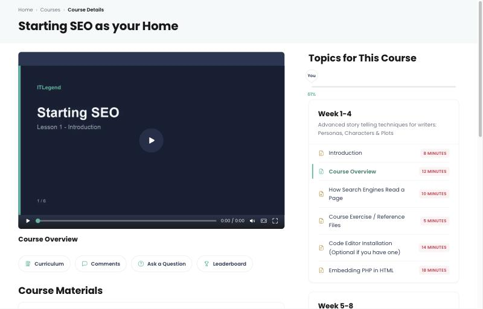
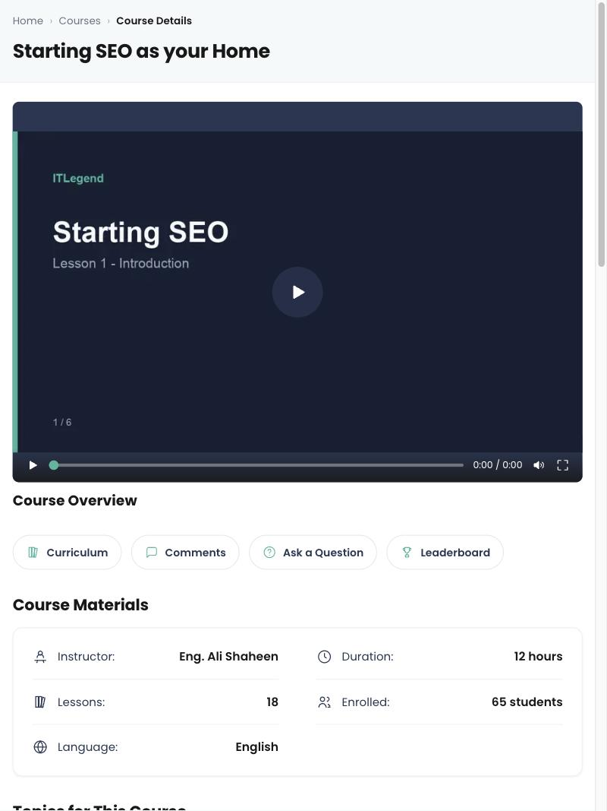
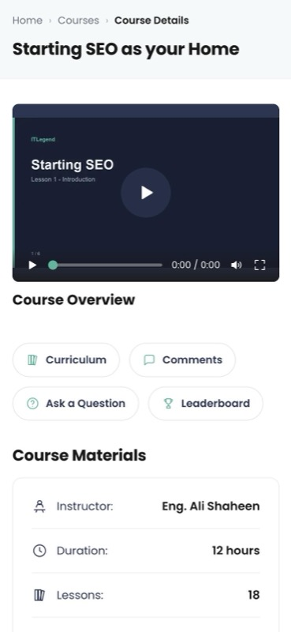

# ITLegend Course Player

A course player built from the ITLegend Figma test: a course list, a lesson page
with a custom video player, the curriculum, comments, and the pop-ups the brief
asks for (PDF, Ask a Question, Leaderboard, Exam).

**Live:** https://course-player-plum.vercel.app/courses

| Desktop                                  | Tablet                                 | Mobile                                 |
| ---------------------------------------- | -------------------------------------- | -------------------------------------- |
|  |  |  |

## Run it

```bash
npm install
npm run dev
```

Then open http://localhost:3000. For the production build:

```bash
npm run build && npm start
```

## What it does

- **Course list** — six courses with artwork, instructor, progress and status.
- **Player** — a native `<video>` with controls written for this project: play,
  seek, elapsed time, mute, Wide mode and Fullscreen (phones are asked for
  landscape where the browser allows it).
- **Lessons** — picked with `?lesson=<id>`, so any lesson is a shareable link.
  The open lesson is marked in the curriculum.
- **Sticky player on phones** — the player pins to the top and the lesson list
  scrolls under it, like YouTube on mobile. A tablet scrolls it away instead.
- **Curriculum** — weeks collapse on mobile, stay open on desktop, and locked
  lessons are not clickable.
- **Section icons** — Curriculum and Comments scroll to their section, Ask a
  Question and Leaderboard open modals.
- **Ask a Question** — the draft survives closing the modal, for the session.
- **Leaderboard** — the student's row is highlighted under a coach message in
  Egyptian Arabic chosen from how far along the course is.
- **Exam** — one question at a time with a countdown that hands the paper in by
  itself, and answers that survive a page reload.
- **Comments** — the list plus a form that adds a comment to the page.
- **Course progress** — the bar fills when it scrolls into view.

## Architecture

### Folder structure

```
src/app         routes: /courses and /courses/[slug]
src/components  ui/ (shared), player/, curriculum/, comments/, modals/, courses/
src/data        the JSON the app reads, plus the coach messages
src/lib         data access (data.ts), progress maths (progress.ts), time (time.ts)
src/types       the shapes everything else imports
src/hooks       useInView, for the progress bar
```

Components are grouped by the part of the page they build rather than by kind,
so a change to the player touches one folder. Every component keeps its styles
next to it in a CSS module, which is why there is no global stylesheet beyond
the tokens in `globals.css`.

### Server and client components

Pages are server components: they read the data, compute progress and render
the markup. Only the parts that need browser state are client components — the
video player, the week accordion, the comment form, the modals and the
scroll-driven progress bar. That keeps the JavaScript that ships tied to what
is actually interactive; the curriculum, the materials table and the page
headers cost nothing on the client.

### Data layer

All reads go through `src/lib/data.ts`, which hands back typed objects from the
JSON in `src/data`. Components never import the JSON directly, so swapping the
files for a real API is a change in one file.

Progress is derived, not stored: `src/lib/progress.ts` turns the lessons into a
percentage, a status and "the lesson you stopped at". The exam is the one piece
of state that is written down, and it goes to `localStorage`; the question draft
goes to `sessionStorage`, since it is meant to last only for the visit.

### Images and performance

Artwork is WebP served through `next/image` with sizes for each breakpoint, and
the lesson poster is marked `priority` because it is the largest paint on the
player page. Every course page is prerendered at build time through
`generateStaticParams`. The four modals are pulled in with `next/dynamic`, so an
exam paper or a PDF viewer only downloads when someone opens it. Poppins and
Cairo come from `next/font`; Cairo ships one weight and is not preloaded, as the
only Arabic on the site sits behind the leaderboard button.

### No dependencies

The player, the modals, the accordion and the exam are built on the platform — `<video>`, `<dialog>`, CSS grid and `:has()` — so the
app ships React, Next and nothing else.

## Accessibility

- A skip link on every page jumps to `<main>`.
- Landmarks and headings follow the page: one `h1`, a labelled `nav`, `aside`
  and `section` for each block.
- The modals are real `<dialog>` elements opened with `showModal()`, so Escape,
  the focus trap and the inert page behind come from the browser.
- Controls carry names (`aria-label`), the open lesson is `aria-current`, the
  exam timer is a polite live region, and the progress bar is a `progressbar`
  with its value.
- The Figma palette is used as sampled for fills, bars and icons. Small text
  carries darker twins of the green and red (`--green-text`, `--red-text`) so
  it clears 4.5:1, and the curriculum's gold icons are decorative — every row
  they sit on is labelled in text.
- Animation is dropped for anyone who asks for reduced motion.

## Measurements

The production build of the player route is 17 kB of route JavaScript and 132 kB
of first-load JavaScript; each page preloads 32 kB of font. Lighthouse has not
been run against the deployed site yet.

## With more time

- A real API and auth behind `src/lib/data.ts`, instead of JSON.
- Tests: the progress maths and the exam scoring are the parts worth covering.
- Marking a lesson complete when its video ends, and syncing that progress.
- Captions for the lesson video.
